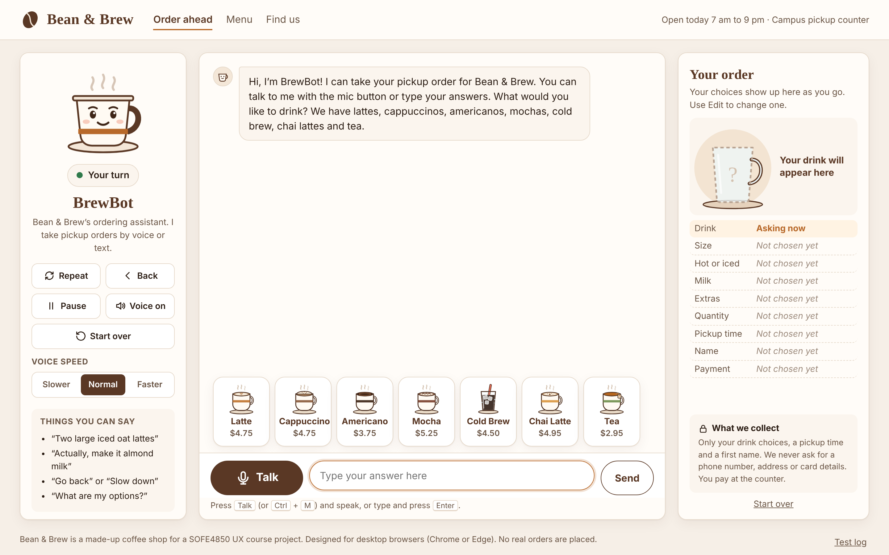
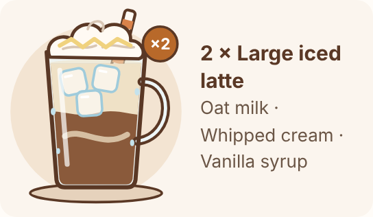
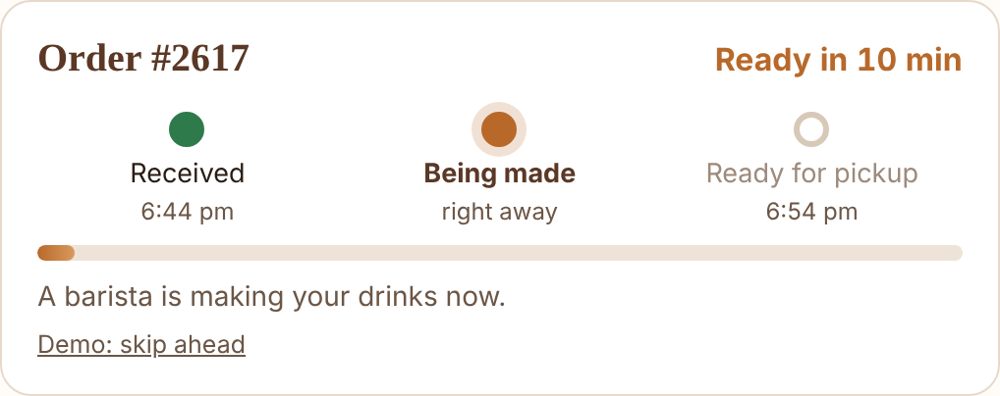
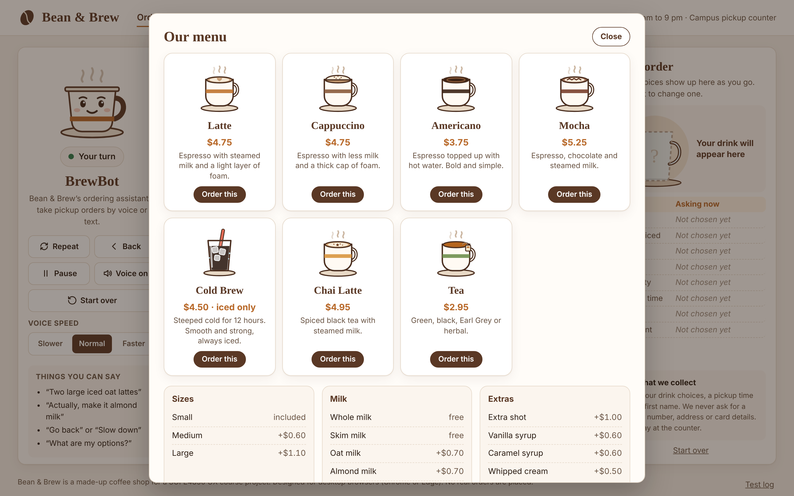
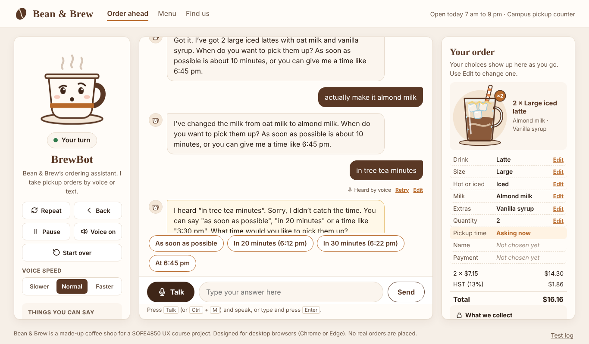

# BrewBot ☕

**A voice and text ordering assistant for Bean & Brew, a campus coffee shop.**

BrewBot is an animated coffee-cup avatar that takes your pickup order by **voice, typing or tapping**, in any mix.
It remembers what you've said, asks only for what's missing, shows your drink being built as you go, and
confirms everything before placing the order. Made for the SOFE4850 UX Project at Ontario Tech University (Fall 2026).

**Live demo:** [https://OmarA7860.github.io/brewbot/](https://OmarA7860.github.io/brewbot/) &nbsp;(open in **Microsoft Edge** or **Google Chrome** on a computer)



---

## Features

| | |
|---|---|
| 🎙️ **Talk, type or tap** | Press **Talk** (or `Ctrl + M`) and speak, type and press Enter, or tap an option. Mix them freely. |
| 🧠 **Several details at once** | "Two large iced oat lattes with vanilla" fills five answers in one go. BrewBot only asks for the rest. |
| 💬 **Talks like a barista** | Understands full sentences and forgives typos ("put Sam as the name", "a shot of vanilla", "935"), answers small talk, price and "do you have…" questions, names any drink it doesn't have and offers the closest one, and suggests the most popular choice if you say "surprise me". |
| 🖼️ **Picture menu** | Every drink has its own illustration, on the Menu panel, the drink buttons and the welcome screen. Tap **Order this** or a favourite to start straight away. |
| ☕ **Live drink preview** | A cartoon mug builds your drink as you answer: colour, size, steam or ice, milk, whipped cream, syrup and quantity. |
| 👀 **Always shows its state** | The avatar's face shows when it is listening, thinking, speaking, confused, paused or done. It glows when it actually hears your voice and nods each time it saves an answer. |
| ✏️ **Fix anything, anytime** | Say "actually, make it almond milk", click **Edit** on any row, or press **Back**. Nothing forces a restart. |
| 🔁 **Recovers from mishearing** | Shows exactly what it heard, with **Retry** and **Edit**. Reads spoken names back before saving them. |
| ✅ **Confirms before ordering** | Reads back the full order and shows it as an easy-to-scan receipt with the total, and only places it after a clear "yes". |
| ⏱️ **Order tracker** | Received → Being made → Ready, with a countdown, a soft chime and a spoken "your drink is ready". Changed your mind? **Cancel** within the first minute. |
| 🗣️ **Natural voice** | A human-sounding British voice: Microsoft's built-in neural voice in Edge, or a free neural voice model (Kokoro) that loads in the background in other browsers. |
| 🐢 **Voice speed** | Slower / Normal / Faster, or just say "slow down". |
| ♿ **Accessible** | Everything works without voice; every spoken line is also text; keyboard shortcuts; high contrast; reduced motion respected. |
| 🔒 **Privacy aware** | Only a first name is collected. Phone numbers, emails and card numbers are refused. You pay at the counter. |

<p align="center">
  
  &nbsp;&nbsp;
  
</p>

<p align="center"></p>

<p align="center"></p>

---

## How to run it

**Target platform:** desktop browser, **Microsoft Edge** (best natural voice) or **Google Chrome**, window 1280 px wide or more.
Voice input needs the page to be served over `http://localhost` or `https`, not opened as a file.

**Option 1: the live link:** open [OmarA7860.github.io/brewbot](https://OmarA7860.github.io/brewbot/) in Edge or Chrome.

**Option 2: start script** (needs Python 3)
- Windows: double-click `start-windows.bat`
- Mac: double-click `start-mac.command` (first time: right-click → Open)
- Then go to **http://localhost:8000** in Edge or Chrome.

**Option 3: command line**
```bash
python -m http.server 8000
# open http://localhost:8000
```

**Option 4: VS Code** with the *Live Server* extension: right-click `index.html` → *Open with Live Server*.

The first time you press **Talk**, allow the microphone.

## How to use it

1. Press **Start my order**.
2. Answer BrewBot's questions by talking, typing or tapping. Try *"two large iced oat lattes with vanilla"*.
3. Change your mind any time: *"actually, make it almond milk"*, an **Edit** link, or **Back**.
4. Check the summary and say **yes**. You get an order number and the tracker.

Useful phrases: *"help"*, *"what are my options"*, *"go back"*, *"repeat that"*, *"slow down"*, *"start over"*.

---

## Conversation test cases

| Test case | What to try | What BrewBot does |
|---|---|---|
| Normal completion | Answer every question, then "yes" | Places the order, shows the order number and tracker |
| Missing information | "a latte" | Keeps it and asks only for size, milk and the rest |
| Invalid answer | "hot chocolate", "extra large", "soy milk", "25 drinks" | Explains what isn't available and suggests the closest option |
| Ambiguous answer | "medium or large", "a coffee" | Asks which one you meant, with buttons |
| Correction | "actually make it almond milk" | Changes only that answer and carries on |
| Voice recognition problem | Mumble an answer | Shows "I heard …" with **Try again by voice** / **Type it instead** |
| Final confirmation | Fill in all details | Reads back the order and total, waits for yes |



---

## Project structure

```
index.html            Page: avatar panel, conversation, order panel, menu and info panels
css/styles.css        Styling, avatar and drink drawings, animations
js/menu.js            Menu data: drinks, sizes, milks, extras, prices and the words people use for them
js/nlu.js             Understanding: finds menu words, numbers, times, names and commands in a message
js/dialogue.js        Conversation manager: fills the 9 order details, checks answers, builds every reply
js/speech.js          Voice input, natural-sounding voice output, voice choice and speed
js/preview.js         Live drink preview
js/drinkart.js        Drink pictures for the menu, drink buttons and welcome screen
js/log.js             Usability test log (time, errors, retries) with CSV export
js/app.js             Connects everything to the page: chat, avatar, buttons, order panel, tracker
tests/                Automated tests
docs/                 Design documents and screenshots
```

### How the pieces fit

```
  talk / type / tap
          │
     speech.js (voice → text)
          │
       app.js ──text──▶ dialogue.js ──uses──▶ nlu.js + menu.js
          ▲                  │
          └──── reply ◀──────┘   (text, buttons, avatar mood)
          │
  speech.js (text → voice) · avatar · order panel · drink preview · tracker
```

The conversation logic has no screen or audio code in it, which is what makes it easy to test.

## Tests

```bash
node tests/dialogue.test.js        # 82 conversation tests, no browser needed

python -m http.server 8123 &       # then, with Playwright installed:
python tests/browser_test.py       # runs every test case in a real browser with a simulated microphone
```

## Usability testing

Click **Test log** at the bottom right of the page during a session. It records how each answer was given,
misunderstandings, corrections, voice retries and time to complete the order, and downloads as a CSV.

## Design documents

Personas, user journey, task flow, conversation flowcharts and wireframes are in
[`docs/BrewBot_Design_Documents.pdf`](docs/BrewBot_Design_Documents.pdf).

## Known limitations

- One kind of drink per order.
- Voice input needs Edge or Chrome and an internet connection (the browser's speech service is online).
- The rule-based understanding can miss unusual phrasing; buttons and typing always work.
- Payment, the shop and order numbers are simulated. Nothing is stored after the tab is closed.

## Built with

Plain **HTML, CSS and JavaScript**: no frameworks and no build step.
Voice input uses the browser's built-in **Web Speech API**. Spoken replies use Edge's built-in neural voices, or
[Kokoro](https://github.com/hexgrad/kokoro) (an open-source text-to-speech model run in the browser with
`kokoro-js`) where those aren't available, with the browser's own voice as a fallback. The avatar and drink preview are hand-drawn SVG animated with CSS.

## Team

| Name | Student ID | Role |
|---|---|---|
| Omar Ahmed | 100919043 | UX research and usability testing |
| Zeyad Ghazal | 100822890 | Interaction and visual design |
| Abdullah Ahmed | 100821709 | Development and voice integration |

SOFE4850 UX Project, Ontario Tech University, Fall 2026.
*Bean & Brew is a made-up coffee shop created for this course project.*
